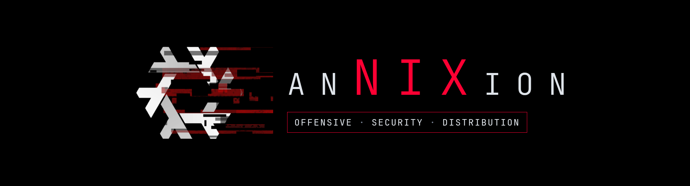
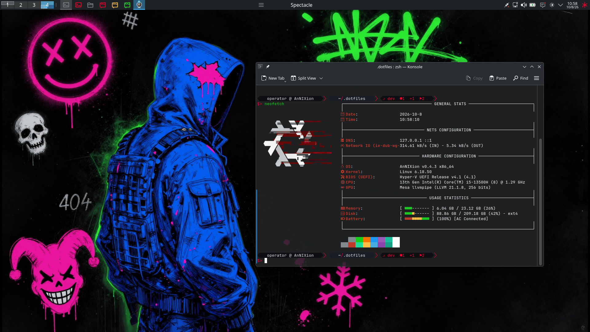

# AnNIXion

**The environment for operators who refuse to wing it.**

 

 

[**Installation**](docs/installation.md) · [**Usage**](docs/usage.md) · [**Customization**](docs/customization.md) · [**Roadmap**](docs/roadmap.md)

---

> **Annexion** *n.* — */a.nɛk.sjɔ̃/* — the act of taking possession of something and making it part of one’s own sphere of control or ownership.

AnNIXion is a Nix-based, opinionated offensive security distribution built around three core workflows: red-team engagements, OSINT and forensic reporting, and sock-puppet management for influence-operation assessment. It combines operational security controls with a declarative, repeatable system configuration.

Customize your `./user/` folder and rebuild your system from your own configuration, without having to redo every customization after a reinstall.

---

## Your new workstation

---

## Concept & mindset

> Did you ever install Kali? Did you ever start customizing it? Did you need to reinstall it because of version drift or operational needs, then redo all your customizations? AnNIXion is built to solve that problem.

AnNIXion provides a ready-to-work environment for three main activities:

- Red-team engagements
- OSINT and forensic reporting
- Sock-puppet management and influence-operation assessment

The distribution is built from NixOS configuration and opinionated dotfiles that provide system defaults. Override them with your own values in `./user/`. The learning curve is steep, particularly if you’re new to Nix, but the result is a system that is easier to reinstall, audit, and maintain for your own workflow or organization.

---

## Features

### Workflow-based approach

- **VPN enforcement for selected profiles:** OSINT and Puppet Master browser profiles run through the VPN-enforced setup, using systemd slices and nftables rules with a kernel-level kill switch. The Red Team profile is configured separately for its Burp workflow; the Unsafe Browser is not VPN-enforced for access to captive portals & other advanced usage.
- **Declarative system:** system configuration is declared in Nix. Rebuilds use the configuration and pinned inputs rather than a sequence of manual customizations.
- **Logging and reporting built into the workflow:** `tlog` and SysReptor are pre-installed, with custom report templates for note-taking and report writing. The `tlog` to SysReptor integration is opt-in.
- **Full-disk encryption:** the installer supports LUKS encryption using `aes-xts-plain64`. There is no recovery-key slot configured, so keep your passphrase safe: losing it means losing access to the encrypted data.

### Auditable by design

AnNIXion includes `annixion-cve-report`, which rebuilds the system closure, scans packages against live CVE data, triages results, and generates reports. Use it to review:

- The package supply chain for the running system and ISO build
- Known CVEs affecting onboard packages
- Package versions and the pinned inputs used to build the system

The version-pinned approach favors a known package state over immediately adopting every upstream update.

### Reproducible beyond limits

> Arguably the best part of AnNIXion: it’s declarative.

Tailor `./user/` to your needs and rebuild your customized system from its configuration. Back up your `~/Documents/` and `./user/` separately, then use them to restore your setup after a fresh install. Rebuilds are driven by your configuration and pinned inputs; the exact result depends on the build environment.

---

## Getting started

AnNIXion installs like a conventional distribution. Download the latest ISO from [Releases](https://github.com/Pyth3rEx/AnNIXion/releases/latest), boot it, and follow the installer.

The installer wizard can generate a new user configuration from your choices or load a provided configuration folder.

The live installer environment uses the `operator` / `operator` login. The installed system’s account credentials are chosen during installation.

AnNIXion is an advanced distribution. The documentation assumes working knowledge of Nix; get familiar with the system before relying on it in the field.

---

## Documentation

| Guide | What it covers |
|---|---|
| [Installation](docs/installation.md) | Prerequisites, deployment, and Hyper-V Enhanced Session |
| [Usage](docs/usage.md) | `annixion-*` commands, browser profiles, Burp, and VPN setup |
| [SysReptor](docs/sysreptor.md) | The self-hosted reporting platform, its report designs, and the `reptor` client |
| [AdaptixC2](docs/adaptixc2.md) | Building and running the C2 teamserver and its native operator client |
| [Session recording](docs/tlog.md) | `tlog-engagement` — opt-in terminal capture, pushed into SysReptor as evidence |
| [Customization](docs/customization.md) | The override system, adding tools, and the development environment |
| [Architecture](docs/architecture.md) | Repository layout, the tool catalog, and how to add a tool |
| [Shell reference](docs/zsh.md) | Prompt, keybindings, aliases, and plugins |
| [Tool index](docs/tool-index.md) | Tools on the system and links to their official manuals |
| [CLI tools](docs/tools.md) | bat, ripgrep, fd, fzf, jq, and other command-line tools |
| [Hardening](docs/hardening.md) | What is disabled, what is deliberately left alone, and how to restore it |
| [Visual identity](docs/visual-identity.md) | Palette, typography, and the mark system |
| [Developer guide](docs/dev.md) | Local CI levels and contributor workflow |
| [Testing](docs/testing.md) | The test suite and the rule that every feature ships with tests |
| [FAQ](docs/faq.md) | Install, boot, browser, proxy, and CI troubleshooting |
| [Roadmap](docs/roadmap.md) | What is done and what is planned |
| [Security](SECURITY.md) | Security posture, bill of materials, and vulnerability reporting |
| [Contributing](CONTRIBUTING.md) | Branch model, conventions, and what to run before a PR |

---

Built on NixOS and proud of the lineage. Not affiliated with, endorsed by, or connected to the NixOS Foundation or the Nix project.

**For authorized security testing, research, and educational use only.**
Obtain explicit written permission before any assessment.
The authors assume no liability for misuse.

